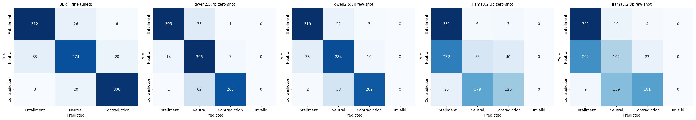

# PA5 — Natural language inference: fine-tuned BERT vs. prompted LLMs

Compares a fine-tuned `bert-base-uncased` classifier with two locally served open-source LLMs (no fine-tuning) on **SNLI**. Each sentence pair is labelled *entailment*, *neutral* or *contradiction*. The LLMs are evaluated with an explicit validation step for unparsable answers.

Run on Kaggle (one Tesla T4). The notebook runs end to end and writes every metric, prediction and figure to `results/`.

## Results

**BERT on the full test set** (9,824 pairs, after one epoch over 549k training pairs):

| Accuracy | Macro F1 | F1 Entailment | F1 Neutral | F1 Contradiction | Training time |
|---:|---:|---:|---:|---:|---:|
| 0.9027 | 0.9025 | 0.909 | 0.872 | 0.927 | 26 min on a T4 |

**BERT vs. LLMs on the first 1,000 test pairs** ([`results/comparison_metrics.csv`](results/comparison_metrics.csv)):

| System | Accuracy | Macro F1 | Invalid rate | Median latency per pair |
|---|---:|---:|---:|---:|
| BERT (fine-tuned) | **0.892** | **0.892** | 0.000 | 12 ms (batch size 1), 0.7 ms batched |
| qwen2.5:7b, zero-shot | 0.877 | 0.879 | 0.000 | 126 ms |
| qwen2.5:7b, few-shot | 0.872 | 0.872 | 0.000 | 128 ms |
| llama3.2:3b, zero-shot | 0.511 | 0.468 | 0.000 | 68 ms |
| llama3.2:3b, few-shot | 0.604 | 0.585 | 0.000 | 67 ms |

Adjusted accuracy equals accuracy here, because no answer was invalid.

**Observations from the numbers**
- The 7B LLM gets within about 1.5 points of fine-tuned BERT with no training, but it is about **10× slower** per pair at batch size 1 and about **175× slower** than batched BERT.
- **Model size matters more than the prompt.** The 3B model labels most *neutral* pairs as *entailment* (232 of 327 zero-shot). Few-shot examples help it (+9 points) but do not close the gap. For the 7B model, few-shot examples made no difference.
- **Formatting was not a problem in this setup.** All 4,000 LLM answers were a single valid label, thanks to a one-word answer format, temperature 0 and a 16-token limit. The parser still tracks invalid answers (multiple labels, no label) and counts them as errors.
- *Neutral* has the lowest F1 for every system (0.872 for BERT on the full test set). qwen2.5 over-predicts it: its largest error is calling *contradiction* pairs *neutral* (62 of 329 zero-shot).

## Method

- **Data:** SNLI from Hugging Face, with label `-1` (no annotator consensus) removed. Exploratory analysis covers label balance, sentence lengths, premise–hypothesis word overlap and negation words per label.
- **BERT:**
  - Input: `[CLS] premise [SEP] hypothesis [SEP]` with segment ids, truncated to 128 tokens (no pair is longer) and padded dynamically.
  - Training: AdamW, lr 2e-5, batch size 32, 1 epoch, fp16, validation every 2,000 steps. The test set is used only after training.
- **LLMs:**
  - Served with Ollama (4-bit builds of `qwen2.5:7b` and `llama3.2:3b`), temperature 0, fixed seed.
  - Prompts: zero-shot, and few-shot with one example per label taken only from the training split.
  - Raw answers are stored unchanged and then parsed with explicit rules (`exact`, `json`, `contained`, `multiple_labels`, `no_label`).
- **Metrics:** accuracy, invalid rate, adjusted accuracy (valid answers only) and macro F1, with invalid answers counted as errors.

## Files

| File | Contents |
|---|---|
| `pa5_snli_bert_vs_llm.ipynb` | Full pipeline: EDA, BERT fine-tuning, LLM inference and parsing, comparison |
| `results/comparison_metrics.csv` | The comparison table above |
| `results/bert_test_metrics.json`, `results/bert_log_history.json` | BERT test metrics and training/validation history |
| `results/bert_predictions_first1000.csv`, `results/llm_parsed_*.csv` | Per-pair predictions, including each raw LLM answer and the parsing rule applied |
| `results/figures/` | All plots (EDA, training curves, confusion matrices, metric comparison) |

SNLI is licensed CC BY-SA 4.0 (Bowman et al., 2015). Sentence pairs are included in the prediction files for error analysis.
